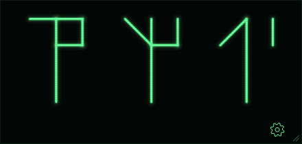

# Cistercian Studio

A Cistercian numeral converter, exact calculator, live clock, and retro Windows desktop widget. Based on the supplied four-corner numeral chart.



**[Download the Windows clock v1.1.0](https://github.com/joeleek1/cistercian-studio/raw/refs/heads/main/dist/downloads/CistercianClock-v1.1.0-Windows.zip)** · [SHA-256 checksum](dist/downloads/CistercianClock-v1.1.0-Windows.sha256) · [Web app](https://cistercian-studio-nov17.joeleek.chatgpt.site) (currently requires the owner's ChatGPT sign-in)

## Desktop widget

Extract the ZIP, then open `CistercianClock.exe`. It runs on Windows 10 and 11 with the built-in .NET Framework 4.x. No installer, administrator access or network connection is needed. The executable is unsigned.

The default **Phosphor** view shows only green Cistercian symbols on black, with a soft glow and subtle CRT scanlines. Read the three symbols left to right as hours, minutes and seconds. An empty stem means zero. Enable the date to add a second row: day, month, year.

Drag the clock to move it; drag an edge or corner to resize. Click the **green cog in the bottom-right corner** for settings. Right-click, double-click and **S** also work. With a transparent background, drag a symbol to move and use the lower-right grip to resize.

| Setting | Options |
| --- | --- |
| Theme | Phosphor green, Amber, Ice, Paper |
| Size | Freely resize, enter pixel dimensions, or choose Small / Medium / Large |
| Transparency | Smooth 0–60% window transparency; optional fully transparent background |
| Date display | Hidden, Cistercian symbols, standard date text, or both |
| Date format | Day/month/year, month/day/year, year-month-day, or weekday and full date |
| Time zone | This device, London, UTC |
| Display | Seconds, date, decimal labels, glow, scanlines |
| Window | Always on top, hide to system tray |

**F1** opens help. **Esc** hides the clock to the tray; double-click its tray icon to restore it. **Ctrl+Q** quits. Settings and position are stored in `CistercianClock.settings` beside the executable. The app does not add itself to startup, change system settings, or collect data.

To upgrade, close the old clock and replace its EXE with the new one. Keep your settings file: existing preferences are retained. The new size and date options save automatically. The long date's Cistercian row uses day/month/year.

### Download warnings

The EXE is **unsigned**. Chrome or Windows may warn about an uncommon download or an unrecognised publisher; the exact warning reported for the first version was not recorded, so its cause is unconfirmed. A checksum verifies that a download matches this build, not that it is safe. See [download security and signing](SECURITY.md) for details and official guidance. Do not disable security protection to run the clock.

To build the widget from source on Windows:

```powershell
./desktop/build.ps1
```

This uses the built-in .NET Framework C# compiler, runs native self-tests, and creates a portable ZIP, a versioned ZIP, SHA-256 checksums and `release-info.json` in `dist/downloads`. Source is in `desktop/`.

## Browser app

Open `dist/index.html` directly in a browser, or with Node.js installed run:

```sh
npm start
```

Then visit `http://127.0.0.1:4173`. No packages need to be installed.

- Convert whole numbers up to 32 significant digits, including negatives.
- Compare addition, subtraction, multiplication and division in both systems.
- Division returns an exact reduced fraction, with a decimal preview.
- Colour the four place values, explore the full symbol key, and export SVG images.
- Watch a live clock and calendar in London, UTC, or device time.
- Download the Windows desktop widget.

## Number conventions

Units occupy the top right; tens the top left; hundreds the bottom right; thousands the bottom left. The digit-six mark is detached from the stem, matching the reference.

Above 9,999, symbols are grouped in base 10,000. For example, **12,345,678** uses the symbols for **1,234** and **5,678**. Internal zero groups are retained. This extension, an empty stem for zero, minus signs, and exact fraction bars are app conventions.

Browser arithmetic uses `BigInt`, including results larger than the input limit. Decimal previews truncate at 12 places and show an approximation sign when a remainder remains. Glyph fractions preserve the exact answer.

## Validation

```sh
npm test
```

The tests cover the reference examples, all 10,000 distinct glyph geometries, large integers, arithmetic, fractions, zero groups, date rollover, leap days and British daylight-saving changes. The desktop build separately tests its geometry, time zones, preference migration, date formats, resize layouts, cog positioning and the settings controls.

Both apps work offline. Clocks follow the device clock; no external time service is used.
